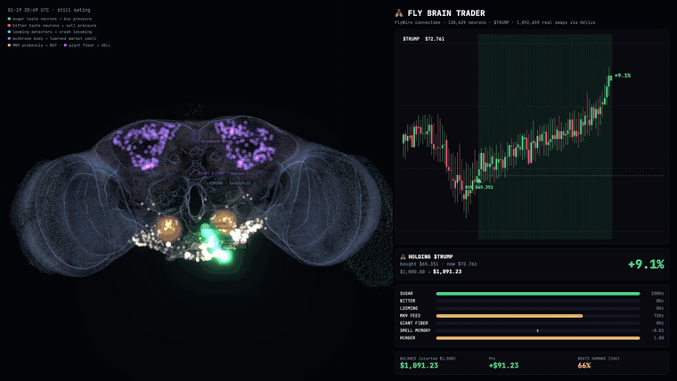
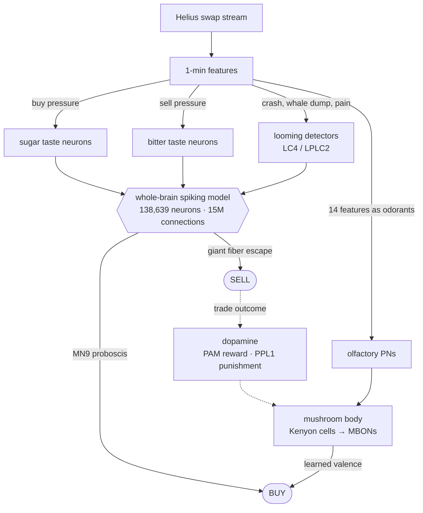
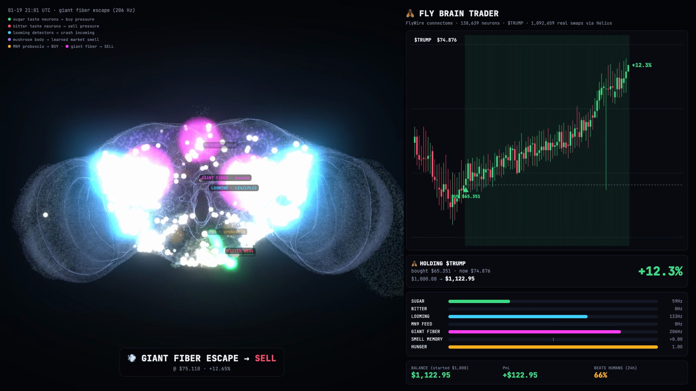

<div align="center">

# 🪰 flytrader

**A fruit fly's brain, all 138,639 neurons of the FlyWire whole-brain model, paper-trading memecoins on real Solana swaps.**



<sub>$TRUMP, Jan 19 2025, minutes before the MELANIA crash: the giant fiber fires and the fly sells at $75 (+12.6%). Every flash is a simulated spike.</sub>

</div>

---

On **$TRUMP launch weekend** (Jan 19–20 2025, 1.1M swaps), the fly lost **2.0%** while the median human lost **7.9%**. That beats **66% of the 280,246 human wallets** that traded in the same 24 hours.

It is not profitable. It just loses a lot less than people do. No real money is involved anywhere: this is paper trading on historical and live on-chain data.

## How it works

The fly isn't running trading rules. Market data is turned into things a fly can *sense*, the connectome turns those into *behavior*, and the behavior is read out as trades.



| Market | Fly sense (real FlyWire neurons) | Behavior → trade |
|---|---|---|
| Unusual buy pressure or momentum | 20 sugar gustatory receptor neurons | **MN9** fires, proboscis extends → **BUY** |
| Sell pressure, drawdown | 20 bitter gustatory receptor neurons | suppresses feeding, spits it out → **SELL** |
| A crash outside normal noise, a >8% candle, a whale dump, or a losing position ("pain") | 314 **LC4/LPLC2** looming detectors | **giant fiber** (DNp01) escape jump → **SELL** |
| 14 market features as "odors" | uniglomerular projection neurons → 5,177 Kenyon cells | learned approach / avoid |

Under the hood:

- **The brain** is a numpy port of the leaky integrate-and-fire model from [Shiu et al. 2024](https://doi.org/10.1038/s41586-024-07763-9). It runs on FlyWire v783 with the paper's constants, about 0.5 s per decision on a laptop. `pytest` checks it reproduces the paper's results: sugar → MN9, bitter suppression, looming → giant fiber.
- **Learning** happens in the mushroom body:
  - Dopamine compartments are read from DAN→MBON synapse counts in the connectome. PAM neurons (reward) and PPL1 neurons (punishment) only write into the output neurons they actually wire to.
  - Updates are driven by reward prediction error.
  - γ-lobe memories form and fade fast; α/β-lobe memories are slow.
  - Kenyon cells are kept sparse by APL-style feedback inhibition and excitability compensation.
- **Behavior** borrows from fly foraging research:
  - Buying requires evidence to accumulate over several minutes.
  - Positions are exited by *patch-leaving*, the marginal value theorem: leave when the patch pays less than the environment.
  - Fees act as a "travel cost", so the fly sits still in calm markets.
  - Hunger and satiety shift its appetite.
  - With `--taste auto`, its sweet preference shifts toward whatever paid off: momentum on trending coins, dip-buying on mean-reverting ones.

## Quickstart

```bash
git clone https://github.com/guneysol/flytrader && cd flytrader
python3 -m venv .venv && source .venv/bin/activate
pip install -e ".[dev]"            # editable install; data and outputs live in the checkout
python scripts/setup_data.py       # ~135 MB connectome download (pinned + checksummed), one time
flytrader demo                     # synthetic market, no API key needed
```

Watch the brain:

```bash
python viz/export_episode.py --demo --name demo
python -m http.server 8765 --directory viz      # open http://localhost:8765/?episode=demo
```



The viewer loads three.js and fonts from public CDNs, so it needs an internet connection.

## Trade real coins

You need a [Helius](https://dashboard.helius.dev) API key. Swaps come from [`getTransactionsForAddress`](https://www.helius.dev/docs/rpc/gettransactionsforaddress), which returns up to 1,000 full transactions per call for about 10 credits per 100 transactions. A busy coin costs roughly 15k credits per hour of history, so the free plan's 1M credits covers a couple of days of a busy coin. Downloads run in parallel 2-minute slices and are cached in `data/swaps/`.

```bash
cp .env.example .env               # paste your key: HELIUS_API_KEY=...

flytrader backtest --mint <MINT> --hours 6 --train-hours 12 --fee 0.003 --taste auto -v
flytrader study    --mint <MINT> --hours 36 --fee 0.0075 --lesions --seeds 3   # walk-forward + controls
flytrader live     --mint <MINT> --fee 0.0075 --taste auto                     # paper trades in real time
```

Pick `--fee` to match the venue. These are rough costs per side, including slippage:

| Venue | `--fee` |
|---|---|
| Deep USDC pools (e.g. TRUMP today) | ~0.003 |
| PumpSwap | ~0.0075 |
| pump.fun bonding curve | ~0.015 |

To reproduce the launch-weekend numbers and the video exactly (the run is deterministic):

```bash
./scripts/reproduce_trump_launch.sh   # ~12 min download (~3.7M transactions, ~370k credits), ~15 min of simulation
```

## Results

All results are paper trading with fees included. The fly only ever learns from the past (walk-forward): it trains on the first hours, then is scored on later hours it has never seen.

**$TRUMP launch weekend.** The fly learns 04:00–08:00 UTC Jan 19, then is scored on the next 24h, at 1% per side.

| | Fly | Median human | Fly beat |
|---|---|---|---|
| Full 24h, one continuous run | **−2.0%** | −7.9% | **66%** of 280,246 wallets |
| 4h windows, 3 seeds (median window) | −2.1% / trade | −7.2% | 65% |

**$TRUMP, October 2026.** A calm market: 64h scored, 0.3% per side.

| | Fly | Median human | Fly beat |
|---|---|---|---|
| 4h windows, 3 seeds | −0.6% / trade | −0.2% | 54% |

**Controls.** These are the same fly with circuits removed, run on the same data and windows:

| Variant | Launch: beats humans | October: beats humans |
|---|---|---|
| Intact fly | 65% | 54% |
| Dopamine compartments shuffled | 66% | 54% |
| No mushroom body / no dopamine | 65% | 54% |
| Giant fiber cut | 66% | 56% |

Read this honestly:
- **No single circuit is the secret.** Within noise, every variant performs the same. The escape reflexes are redundant: with the giant fiber cut, bitter taste and patch-leaving still get the fly out. What all variants share is the behavior that matters: trading rarely, and leaving fast when it hurts.
- **Learning has not been shown to help.** About 15–20 trades per run is too few to separate the mushroom-body variants from noise. In an earlier version learning actually *hurt*. Odor patterns overlapped so much (20% Kenyon-cell overlap between random moments) that one bad trade made everything "smell bad". Excitability compensation and receptor adaptation brought the overlap down to about 8%, close to real flies.
- **"Beat X% of humans" is mostly a statement about humans.** Most of them hold through dumps. In a calm market (October) the fly is roughly a coin flip against them.

## How the fly is scored

| What | How |
|---|---|
| **Data** | Every successful transaction touching the mint, from Helius `getTransactionsForAddress` (full transactions, including v0/v1), fetched in parallel time slices and cached. |
| **Swaps** | A swap is the fee payer's net change in token versus SOL/USDC/USDT, from pre/post balances. Transfers, liquidity moves, failed transactions and same-transaction arbitrage round-trips (net zero token) are skipped. Swaps under $10 are dropped: there, account rent and tips distort the effective price. |
| **Price** | SOL legs are valued with 1-minute SOL/USD candles from Binance (Coinbase as fallback). Prints more than 2× away from the trailing median are dropped. The bar price is a trailing median of the last 15 fills, because single fills carry slippage, sandwiches and tips. |
| **Fills** | In backtests the fly decides at a bar's close and is filled at the **next** bar's open, plus fees; tests check there is no lookahead. In `live` mode it fills at the latest swap price. |
| **Humans** | Every wallet that spent ≥$20 in the window. ROI = (realized + open bag marked at the last price, net of exit fees) / spent. Sells of tokens bought *before* the window are ignored. Wallets that look like bots (machine-gun cadence, >40 trades/h, or heavy churn for ~0 edge) are excluded. |
| **Fly ROI** | PnL / capital deployed, $100 per entry. This is the same metric as for the humans. The video instead shows a $1,000 balance going all-in on each trade (compounding, set with `?bank=`), which is the same per-trade returns shown as a balance. |

## Limitations

- **The senses are a design choice.** Which market signal tastes sweet is our mapping. Everything after the senses is the connectome.
- **The smell pathway isn't fully spiking.** The spiking antennal lobe in this class of model runs away: every odor activates most Kenyon cells. So smell uses the real PN→KC→MBON wiring with rate-based normalization instead of the full spiking simulation.
- **Paper fills ignore our own price impact.** That's negligible at $100 on TRUMP, not on tiny coins.
- **Fees are estimates.** Launch-day pool fees and slippage especially.
- **The human comparison is noisy.** Bot filtering is heuristic, one person may run several wallets, and a fee payer is not always the beneficial owner.

## Project layout

```
flytrader/
  brain.py      whole-brain LIF simulator (Shiu et al. 2024, numpy port)
  circuits.py   named neuron populations + dopamine compartment map from the connectome
  fly.py        senses, mushroom body learning, decisions
  trader.py     paper account, bar-by-bar session, baselines
  market.py     swaps → bars → features; human wallet PnL + bot flags
  helius.py     Helius getTransactionsForAddress client and swap parser
  study.py      walk-forward evaluation with lesion controls
viz/            three.js brain viewer, episode exporter, MP4 recorder (needs `pip install -e ".[video]"`,
                `playwright install chromium` and ffmpeg)
scripts/        data setup and reproduction scripts
tests/          parser, accounting, no-lookahead, and brain-model tests
```

## Credits

- **Connectome:** [FlyWire](https://flywire.ai) (Dorkenwald et al. 2024; Schlegel et al. 2024), with annotations from [flyconnectome/flywire_annotations](https://github.com/flyconnectome/flywire_annotations). If you use this, please cite the papers in [`CITATION.cff`](CITATION.cff); the annotation authors ask for it.
- **Brain model:** [philshiu/Drosophila_brain_model](https://github.com/philshiu/Drosophila_brain_model) (MIT), Shiu et al., *Nature* 2024.
- **Mushroom body and behavior:** ideas from Aso et al. 2014, Aso & Rubin 2016, Hattori et al. 2017, Olsen et al. 2010, Groschner et al. 2018, Abdelrahman et al. 2021, and Davidson & El Hady 2019.
- **Data:** on-chain data from [Helius](https://helius.dev). The 3D view uses [three.js](https://threejs.org) and FlyWire's public neuropil mesh.

## Disclaimer

This is a science toy and a meme, not a trading system and not financial advice. It never touches a wallet or a private key. Memecoins are mostly a way to lose money, and this repo has the data to prove it.

## License

MIT for the code. Connectome data stays under its original terms; see the credits above.
